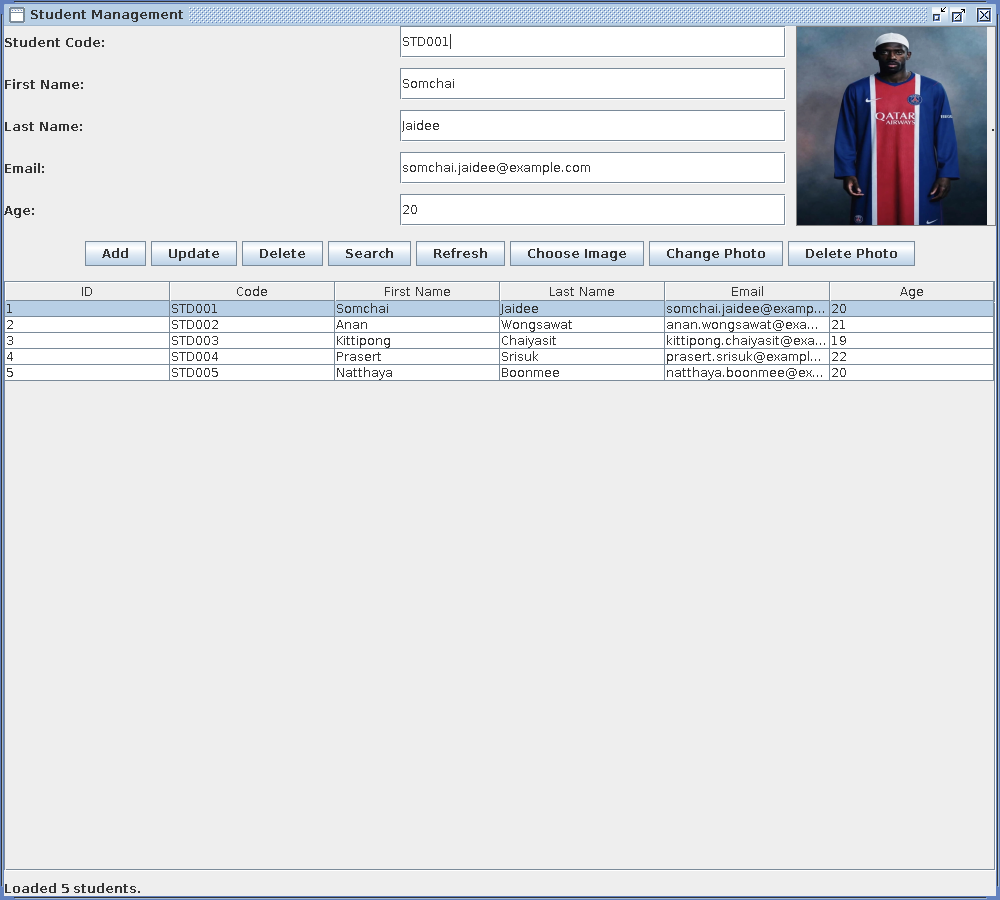

# JDBC Lab

โปรเจกต์ฝึก JDBC

## About
**ระบบจัดการข้อมูลนักศึกษา (Student Management)** แอปเดสก์ท็อปด้วย Java Swing ที่เชื่อมต่อ MySQL ผ่าน JDBC
ใช้ฝึกเขียน JDBC ตั้งแต่ CRUD พื้นฐาน จนถึงทำเป็นหน้าจอใช้งานจริงพร้อมรูปนักศึกษา



## Features
- **เพิ่ม / แก้ไข / ลบ** ข้อมูลนักศึกษา (รหัส ชื่อ นามสกุล อีเมล อายุ)
- **ค้นหา** ตามรหัสนักศึกษา
- **ตารางรายชื่อ** คลิกแถวเพื่อโหลดข้อมูลและรูปเข้าฟอร์ม
- **รูปนักศึกษา** เลือก / เปลี่ยน / ลบ เก็บในฐานข้อมูลเป็น BLOB (ไม่เกิน 2 MB)
- ตรวจข้อมูลก่อนบันทึก (ช่องว่าง อายุ รหัสหรืออีเมลซ้ำ) และแจ้งผลที่แถบสถานะด้านล่าง
- ใช้ PreparedStatement ทุกคำสั่ง SQL และอ่านค่าเชื่อมต่อจาก environment variable

## Roadmap

**Phase 1: เตรียมฐานข้อมูล**
- [x] เชื่อม MySQL ด้วย `Db.connect()` และเข้าใจโครงสร้างตาราง `students`
- [x] เข้าใจ Primary Key / AUTO_INCREMENT
- [x] เข้าใจ PreparedStatement (`?`), try-with-resources, SQLException

**Phase 2: CRUD ใน Console**
- [x] INSERT: `insert()` คืน `long` ด้วย `RETURN_GENERATED_KEYS`
- [x] SELECT: `findByCode()` (ไม่พบคืน null), `listAll()`, `Student.from(r)`
- [x] UPDATE: `update()` (แก้ทุกฟิลด์) คืนจำนวนแถว (ไม่พบ = 0 rows)
- [x] DELETE: `deleteByCode()` คืนจำนวนแถว (ไม่พบ = 0 rows)
- [x] จัดการ student_code / email ซ้ำ

**Phase 3: GUI (Swing)**
- [x] ฟอร์มกรอกข้อมูล + ปุ่ม Add / Update / Delete / Search / Refresh
- [x] JTable แสดงรายชื่อ คลิกแถวเพื่อโหลดข้อมูลเข้าฟอร์ม
- [x] รูปนักศึกษา: เลือก / เปลี่ยน / ลบ เก็บเป็น BLOB ไม่เกิน 2 MB
- [x] แสดงสถานะและ error ที่แถบด้านล่างหน้าต่าง

## Setup
สร้าง database และตาราง (ค่า default ของโปรเจกต์ใช้ database ชื่อ `jdbc_lab`):

```sql
CREATE DATABASE IF NOT EXISTS jdbc_lab;
USE jdbc_lab;

CREATE TABLE students (
    id           BIGINT AUTO_INCREMENT PRIMARY KEY,
    student_code VARCHAR(20)  NOT NULL UNIQUE,
    first_name   VARCHAR(100) NOT NULL,
    last_name    VARCHAR(100) NOT NULL,
    email        VARCHAR(150) UNIQUE,
    age          INT,
    created_at   TIMESTAMP NULL DEFAULT CURRENT_TIMESTAMP
);

CREATE TABLE student_photos (
    student_id BIGINT PRIMARY KEY,
    photo      MEDIUMBLOB NOT NULL,
    FOREIGN KEY (student_id) REFERENCES students(id) ON DELETE CASCADE
);
```

ถ้าไม่ตั้ง environment variable โปรแกรมจะใช้ค่า default: `DB_URL` = `jdbc:mysql://localhost:3306/jdbc_lab?...`, `DB_USER` = `root`, `DB_PASS` = ค่าว่าง (ต้องตั้ง `DB_PASS` ถ้า MySQL มีรหัสผ่าน)

## Requirements
- JDK 25+
- MySQL + [MySQL Connector/J](https://dev.mysql.com/downloads/connector/j/)
- ตั้งค่าการเชื่อมต่อผ่าน environment variable (`DB_URL`, `DB_USER`, `DB_PASS`) ห้ามใส่รหัสผ่านในโค้ด

## Structure
```
jdbc_lab/
├── Makefile
├── README.md
├── images/         # รูปตัวอย่างสำหรับทดสอบ (ไฟล์ที่เลือกจาก GUI)
└── src/
    ├── model/      # Student (record)
    ├── dao/        # SQL / JDBC ทั้งหมด: Db, StudentDao (ข้อมูลนักศึกษา), PhotoDao (รูปภาพ)
    ├── service/    # Transaction, รายงาน (ยังไม่มี)
    └── gui/        # StudentForm (Swing)
```

## Run
```
export DB_PASS=<รหัสผ่าน MySQL>   # ตั้ง DB_URL, DB_USER เพิ่มได้ถ้าจำเป็น
make run
```

ต้องรันจากโฟลเดอร์ `jdbc_lab` เพราะ GUI เปิดหน้าต่างเลือกรูปจากโฟลเดอร์ `images/` แบบ path สัมพัทธ์
